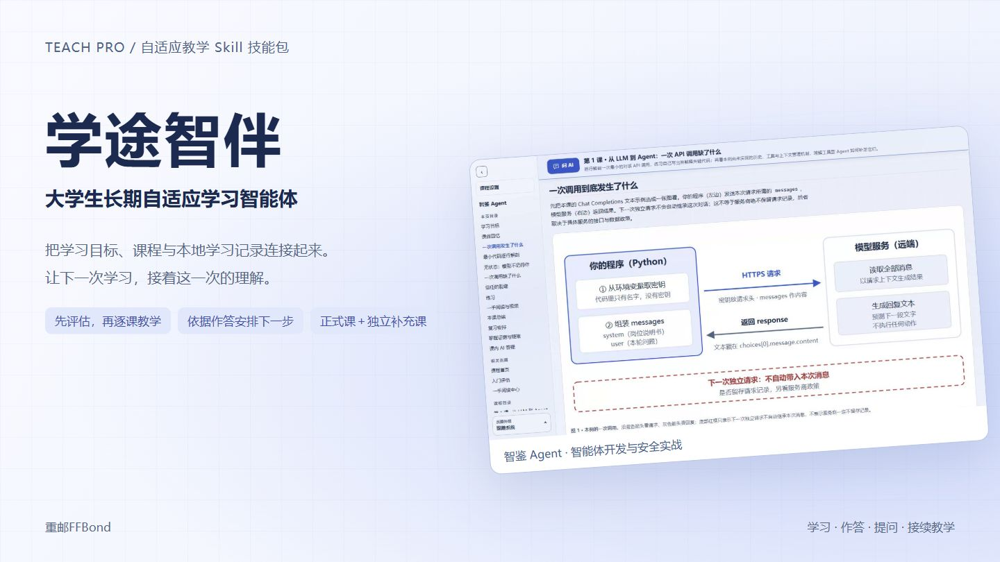
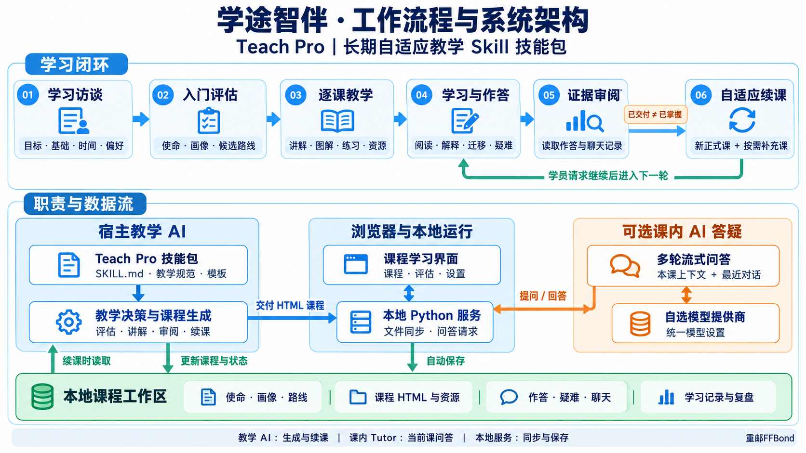
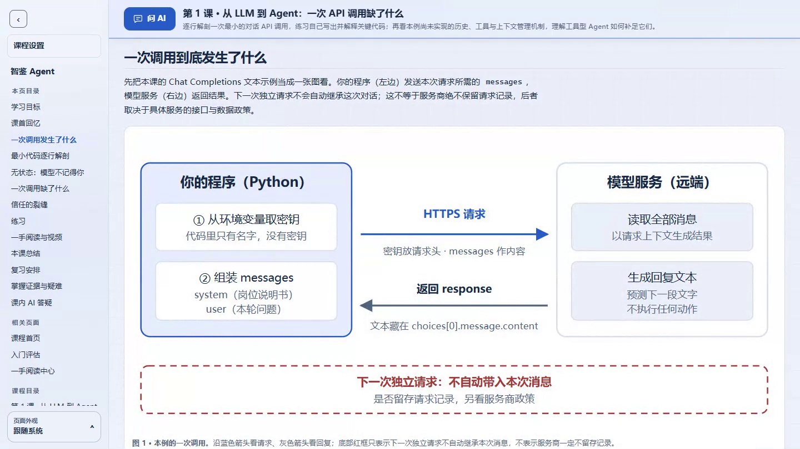
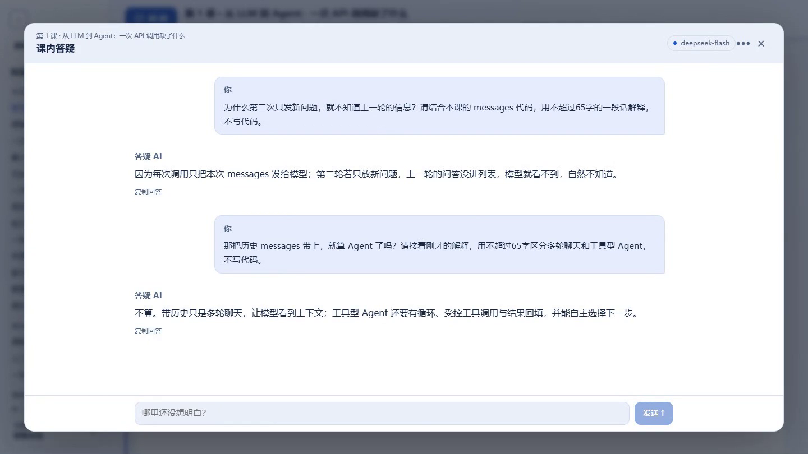
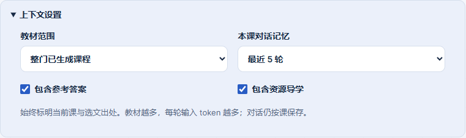

# 学途智伴 · Teach Pro

面向长期学习的自适应教学 Skill。把学习目标、课程与本地学习记录连接起来，先评估基础，再逐课教学，依据作答与疑难安排下一步。

当前版本：**1.1.0-rc.15**。正式课逐节推进，独立补充课巩固难点，课内答疑辅助理解。

rc.15 支持整门已生成教材上下文、当前提问页与选文段落定位，统一设置页可调整教材范围和对话记忆。已有课程升级答疑组件后，重启课程服务并刷新网页即可，原作答、聊天和模型配置保留。

[在线课程与操作演示](https://roamerfly.github.io/teach-pro-skill/) · [完整示例课程](./example/competition-demo-rc12/README.md)

[](https://roamerfly.github.io/teach-pro-skill/)

## 用途与价值

系统学习需要持续回答：已经能够完成什么、哪些问题尚未解决、下一步应该学什么。课程、笔记、练习与 AI 对话分散时，学习者还需自行整理进度、重建上下文和安排课程。

学途智伴将评估、逐课讲解、作答与续课组织在同一个课程工作区，让下一次教学接着上一次的实际表现推进。

- **接续学习**：本地保存目标、课程状态与学习记录，新会话读取后继续教学。
- **按表现安排下一步**：结合解释、应用、迁移和疑难调整目标、难度与练习支架。
- **主线与难点协同**：正式课推进新目标，独立补充课处理具体难点，分别记录。

学习者主要负责阅读、作答和提问，教学 AI 维护路线与进度，减少反复说明背景和自行编排课程的负担。

## 工作流程

访谈与评估确定起点，网页课程承载讲解与练习，本地记录连接前后两次教学。学员请求继续时，教学 AI 读取作答与疑难，安排下一节正式课及按需补充课。



Skill 提供教学规则、模板与本地工具；宿主教学 AI 负责生成与续课，课内答疑模型负责当前课的讨论。

## 核心特性

- **自适应教学**：建立学员画像与学习路线，依据学习证据选择下一课。
- **主线与补充**：每次推进一节正式课，按需同时提供补充课，分别展示与保存。
- **图解教学**：通过流程图、架构图与代码建立理解，配合一手阅读和视频导学。
- **主题化页面**：按学习主题选择课程级视觉风格与灵活版式，侧栏可折叠。
- **资源导学**：精选一手阅读与视频，标明学习位置、用途和任务。
- **本地学习记录**：自动保存作答、疑难与聊天，供课程生成 AI 参考。
- **课内 AI 答疑**：冻结标题栏一键打开大弹窗，紧凑输入、真实流式回复、多轮交流与 Markdown 排版。

## 快速开始

### 安装 Skill

在 Codex 中请求 Skill Installer 安装：

```text
$skill-installer 从 https://github.com/RoamerFly/teach-pro-skill 安装 teach-pro 目录。
```

手动安装时，将完整的 `teach-pro/` 目录放入目标环境的技能目录。Codex 的安装与发现方式见 [官方技能文档](https://learn.chatgpt.com/docs/build-skills)。

### 创建课程

显式调用 `teach-pro`，提供学习目标、已有基础和可投入时间：

```text
$teach-pro
我想学习数据分析，目标是独立完成一份分析报告。
我会基本 Python，每周可投入五小时，偏好图解和逐步讲解。
请评估基础、规划路线并生成第一课。
```

在课程工作区继续讨论、提交练习或请求下一课。AI 会读取已同步的学习记录，处理疑难并调整后续课程。

### 运行课程

本地服务需要 **Python 3.11+**，核心服务使用标准库。在生成的课程目录中启动：

| 平台 | 启动方式 |
| --- | --- |
| Windows | 双击 `start-course.cmd` |
| macOS | 双击 `start-course.command` |
| Linux | 运行 `sh start-course.sh` |

启动后，作答和聊天会保存到课程目录。直接打开 `index.html` 可静态阅读；自动文件保存与 AI 答疑需要本地服务。

## 课程示例

[校园消费统计自适应案例](./teach-pro/references/examples/statistics-adaptive/README.md)展示同一首课的两组模拟作答，以及对应的支持调整与正式／补充交付。在 Skill 根目录运行 `python scripts/build_adaptive_example.py <新目录>`，即可查看完整图解、练习、资源导学和决策依据；这是可复现教学案例，不是模型现场生成。

[比赛 Demo：智鉴 Agent](./example/competition-demo-rc12/README.md) 包含入门评估、三节正式课、一节关联补充课、一手阅读中心与统一模型设置。展示主线推进、按需补充与本地学习记录的衔接。

```sh
git clone https://github.com/RoamerFly/teach-pro-skill.git
cd teach-pro-skill/example/competition-demo-rc12
```

随后使用对应平台的启动器打开课程。此 Demo 使用合成场景，内容经人工校核；后续课节依据新作答生成。[旧版展示](./example/competition-demo-zhi-jian-agent/README.md)保留为历史对照。

[早期课程与项目案例](./example/ai-agent-security-intelligence/README.md) 保留字幕视频和安全情报实验代码，供对照使用。

## 界面预览

### 图解与练习

课程导航、冻结标题栏、图解和代码围绕当前学习目标组织；理解后通过选择题与开放练习留下作答记录。



### 多轮课内答疑

围绕当前课连续提问，也可联系之前的课程；回答流式显示，支持 Markdown 排版和按课保存。下图来自演示视频中 DeepSeek 的实际两轮回答。



<details>
<summary>查看统一模型与上下文设置界面</summary>

服务预设、遮蔽密钥、获取模型、测试连接与设备记忆集中在“课程设置”。上下文设置可选择整门教材或当前课、参考答案、资源导学和对话记忆，连接后回到当前课继续提问。



</details>

[观看完整操作演示](https://roamerfly.github.io/teach-pro-skill/#video) · [下载课程与 Skill](https://roamerfly.github.io/teach-pro-skill/#experience)

## AI 答疑与隐私

每门课程默认提供左侧置顶“课程设置”，无需配置 AI 也能学习。需要课内答疑时，再启动本地服务并配置服务、API Key 和模型。支持 OpenAI-compatible、OpenAI、DeepSeek、Ollama 与自定义地址，以及主动获取模型列表。

- API Key 默认遮蔽；默认勾选“记住此设备”，保存时使用系统凭据存储，支持重启恢复，不回填浏览器或写入课程文件。取消勾选可仅用于本次会话。
- 统一使用 Python keyring 对接 Windows、macOS 与 Linux 系统凭据存储；Linux 还需可用的桌面密钥环与 D-Bus。
- 默认带入同课程已生成网页教材，明确当前提问页和选文出处；“上下文设置”可切换仅当前课、参考答案、资源导学与本课记忆轮数。教材和对话越多，每轮输入 token 越多；连接测试不发送教材。
- 作答、聊天和本地配置已加入忽略规则，请勿提交密钥或敏感资料。

本地服务仅面向单用户本机使用。课内答疑与课程生成相互独立，更新 Skill 不会自动更新已生成的课程。

启动器自动检查密钥存储依赖，首次缺少时联网安装到课程专用 `.teach-runtime/`，准备完成后直接打开课程；后续启动复用环境，不改全局 Python，无需手动安装参数。准备失败仍可阅读，取消记住选项可使用会话答疑；离线启动可加 `--session-only` 跳过准备。

## 项目结构

```text
teach-pro/     Skill 指令、课程模板与运行资源
example/       课程案例与实验代码
evals/         合成案例与可复现检查
```

在仓库根目录发布 Skill ZIP 时从 Git 归档，保留 macOS/Linux 启动脚本的可执行权限：

```sh
git archive --format=zip --prefix=teach-pro/ --output=teach-pro-1.1.0-rc.15.zip HEAD:teach-pro
```

### 双版本发布

日常使用版保留当前目录和兼容元数据；赛事提交版使用顶层中文字段，将教学规范归入 `references/specs/`、页面模板归入 `assets/templates/`，面向校园生活赛道。两者由同一 Git 提交构建，教学与运行功能一致，不维护第二套源码。

```sh
python example/competition-materials/rc12/scripts/package_submission.py <日常版目录> --ref <提交> --profile normal_use --skill-only --extract
python example/competition-materials/rc12/scripts/package_submission.py <赛事版目录> --ref <提交> --profile competition_submit --extract
```

输出目录必须位于仓库外且为空或尚不存在。目录中提供可直接导入的 `teach-pro/`、ZIP 与逐文件来源校验；赛事版另附完整参赛材料包。参考评审规则适配不等同于官方成绩。

教学行为验收见[三项稳定化关卡](./evals/competition-gates.md)；展示与发布校核见 [Demo 验收记录](./evals/records/2026-10-01-competition-demo-review.md)和 [在线入口验收记录](./evals/records/2026-10-11-pages-upload-ready.md)。

## 文档与反馈

- [Skill 使用说明](./teach-pro/README.md)
- [新版参赛说明与视频制作方案](./example/competition-materials/rc12/README.md)
- [课程工作区规范](./teach-pro/COURSE-WORKSPACE-SPEC.md)
- [资源选择策略](./teach-pro/RESOURCE-SELECTION-POLICY.md)
- [本地同步规范](./teach-pro/LOCAL-SYNC-SPEC.md)
- [AI 答疑规范](./teach-pro/LOCAL-TUTOR-SPEC.md)
- [评测方案与合成案例](./evals/README.md)
- [更新记录](./teach-pro/CHANGELOG.md)

由 [RoamerFly](https://github.com/RoamerFly) 维护。问题反馈与改进建议请提交 [Issue](https://github.com/RoamerFly/teach-pro-skill/issues)。
